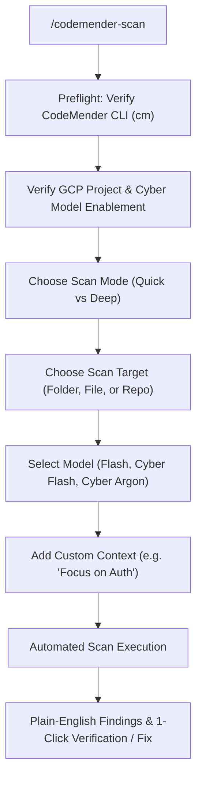

# CodeMender Easy Scan for Google Antigravity

[](https://cloud.google.com)
[](https://opensource.org/licenses/MIT)

A streamlined, non-developer-friendly **Google Antigravity (`agy`)** skill and plugin for scanning codebases with **Google CodeMender (`cm`)** and **Vertex AI Cyber Foundation Models** (`gemini-3.8-flash-cyber`, `gemini-4-argon-cyber-permissive`).

Designed for security analysts, IT administrators, and non-developers who want straightforward vulnerability discovery, exploit validation, and automated remediation without dealing with complex CI/CD gate scripts or shell plumbing.

---

## ⚡ Quick Start: 1-Line Installation

Clone this repository directly into your Antigravity plugins directory:

```bash
git clone https://github.com/mikadevonshire-design/codemender-scan.git ~/.gemini/config/plugins/codemender-scan
```

*That's it! Antigravity automatically detects the plugin and enables the `/codemender-scan` slash command across all your workspaces.*

---

## 🚀 How to Use

In any Antigravity chat session, type:

```text
/codemender-scan
```

Antigravity will guide you through an interactive setup:



### The 5 Guided Prompts:
1. **GCP Project**: Automatically detects your active project or allows you to specify a Fairwind-allowlisted project (e.g., `codemender-oss`).
2. **Scan Mode**:
   - **Quick Scan (`--quick`)**: Fast single-session scan (typically 3–8 minutes).
   - **Deep Scan**: Concurrent per-file deep audit across the entire codebase.
3. **Target**: Choose your current folder, a subcomponent (e.g., `./src/`), or an isolated file.
4. **Model Version**: Choose between `gemini-3.8-flash` (General Preview), `gemini-3.8-flash-cyber`, or `gemini-4-argon-cyber-permissive`.
5. **Custom Context (`-c`)**: *(Optional)* Add specific testing focus (e.g. *"Focus on authentication and session hijacking"* or *"Prioritize SQL injection"*).

---

## 📋 Prerequisites

1. **Google Cloud SDK (`gcloud`) & Credentials**:
   ```bash
   gcloud auth application-default login
   ```
2. **Google CodeMender CLI (`cm`)**:
   If not already installed, download the CLI package:
   ```bash
   # Linux x86_64:
   curl -L -o cm-linux-amd64.zip "https://artifactregistry.googleapis.com/download/v1/projects/cmoc-prod/locations/us/repositories/codemender-cli-production/files/cm%3Astable%3Acm-linux-amd64.zip:download?alt=media"
   unzip -o cm-linux-amd64.zip
   sudo mv cm /usr/local/bin/cm
   ```

---

## 🔍 Features & Capabilities

- **Zero False-Positive Fatigue**: Unlike traditional static scanners, CodeMender allows you to run `cm find verify <id>` to synthesize and execute an active Proof-of-Concept (PoC) exploit in a local sandbox to prove exploitability.
- **Automated Verified Patching**: Run `cm fix <id>` to synthesize fixes, execute test suites (`rspec`, `pytest`, `npm test`), and verify that the vulnerability is closed without regressions.
- **Plain-English Reporting**: Translates complex CWE vulnerability classifications and code traces into plain business-impact summaries.
- **Self-Contained Artifacts**: Automatically saves structured JSON findings and executive summaries to `./reports/codemender/`.

---

## 📁 Repository Structure

```text
codemender-scan/
├── plugin.json                              # Antigravity plugin manifest
├── README.md                                # Documentation and quickstart
├── LICENSE                                  # MIT License
└── skills/
    └── codemender-scan/
        └── SKILL.md                         # Core Antigravity skill instructions
```

---

## 📄 License

This project is licensed under the [MIT License](LICENSE).
