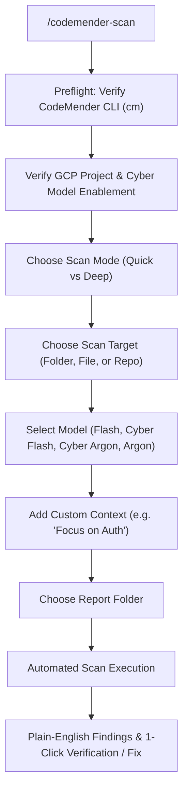

# CodeMender Easy Scan for Google Antigravity

[](https://cloud.google.com)
[](https://opensource.org/licenses/MIT)

A streamlined, non-developer-friendly **Google Antigravity (`agy`)** skill and plugin for scanning codebases with **Google CodeMender (`cm`)** and **Vertex AI Cyber Foundation Models** (`gemini-3.8-flash-cyber`, `gemini-4-argon-cyber-permissive`).

Designed for security analysts, IT administrators, and non-developers who want straightforward vulnerability discovery, exploit validation, and automated remediation without dealing with complex CI/CD gate scripts or shell plumbing.

---

## ⚡ Quick Start: 1-Line Installation

Clone this repository directly into your Antigravity plugins directory:

```bash
git clone https://github.com/mikadevonshire-design/codemender-scan.git ~/.gemini/config/plugins/codemender-scan
```

*That's it! Antigravity automatically detects the plugin and enables the `/codemender-scan` slash command across all your workspaces.*

---

## 🚀 How to Use

In any Antigravity chat session, type:

```text
/codemender-scan
```

Antigravity will guide you through an interactive setup:



Before scanning, it checks your GCP project: it detects your active project (or lets you pick another allowlisted one), checks the required APIs and your access, and sets up a `.codemender/` workspace in the repo.

### The 5 Guided Prompts:
1. **Scan Mode**:
   - **Deep Scan (Default)**: Concurrent per-file deep audit across the entire codebase.
   - **Quick Scan (`--quick`)**: Fast single-session scan (typically 3–8 minutes). May have false positives; use `cm verify` to triage.
2. **Target**: Choose your current folder, a subcomponent (e.g., `./src/`), or an isolated file.
3. **Model Version**:
   - `gemini-3.8-flash` (Default): fast general-purpose scanning.
   - `gemini-3.8-flash-cyber`: security-specialized (Fairwind allowlist required).
   - `gemini-4-argon-cyber-permissive`: deep exploit-path analysis (Fairwind allowlist required).
   - `gemini-4-argon`: high-capability standard model for exhaustive audits.
4. **Custom Context (`-c`)**: *(Optional)* Add specific testing focus (e.g. *"Focus on authentication and session hijacking"* or *"Prioritize SQL injection"*).
5. **Report Folder**: Where to save the exported findings (Default: `.codemender/reports/`).

---

## 📋 Prerequisites

1. **Google Cloud CLI (`gcloud`) & Credentials**:
   ```bash
   gcloud auth application-default login
   ```
2. **Google CodeMender CLI (`cm`)**:
   The CLI is in Public Preview for a limited set of customers, so request access through your Google Cloud sales team first.
   Don't have `cm` yet? `/codemender-scan` detects your platform and shows you the exact commands. To install it yourself, pick your file:

   | Platform | `<FILE>` |
   | :--- | :--- |
   | Linux x86_64 / ARM64 | `cm-linux-amd64.zip` / `cm-linux-arm64.zip` |
   | macOS Intel / Apple silicon | `cm-darwin-amd64.zip` / `cm-darwin-arm64.zip` |
   | Windows x86_64 / ARM64 | `cm-windows-amd64.zip` / `cm-windows-arm64.zip` |

   Then download it and install it (Linux / macOS):
   ```bash
   gcloud artifacts generic download --project=cmoc-prod --location=us \
     --repository=codemender-cli-production --package=cm --version=stable \
     --name=<FILE> --destination=./
   unzip -o <FILE>
   chmod +x cm
   sudo mv cm /usr/local/bin/cm
   cm --version
   ```
   For Windows, curl, or PowerShell steps, see the [official setup guide](https://docs.cloud.google.com/gemini-enterprise-agent-platform/agents/codemender/set-up-environment#download-cli).

---

## 🔍 Features & Capabilities

- **Zero False-Positive Fatigue**: Unlike traditional static scanners, CodeMender allows you to run `cm verify <id>` to synthesize and execute an active Proof-of-Concept (PoC) exploit in a local sandbox to prove exploitability.
- **Automated Verified Patching**: Run `cm fix <id>` to synthesize fixes, execute test suites (`rspec`, `pytest`, `npm test`), and verify that the vulnerability is closed without regressions.
- **Plain-English Reporting**: Translates complex CWE vulnerability classifications and code traces into plain business-impact summaries.
- **Self-Contained Artifacts**: Automatically saves structured JSON findings and executive summaries to `.codemender/reports/` in the scanned repo (git-ignored automatically).

---

## 📁 Repository Structure

```text
codemender-scan/
├── plugin.json                              # Antigravity plugin manifest
├── README.md                                # Documentation and quickstart
├── LICENSE                                  # MIT License
└── skills/
    └── codemender-scan/
        └── SKILL.md                         # Core Antigravity skill instructions
```

---

## 📄 License

This project is licensed under the [MIT License](LICENSE).
